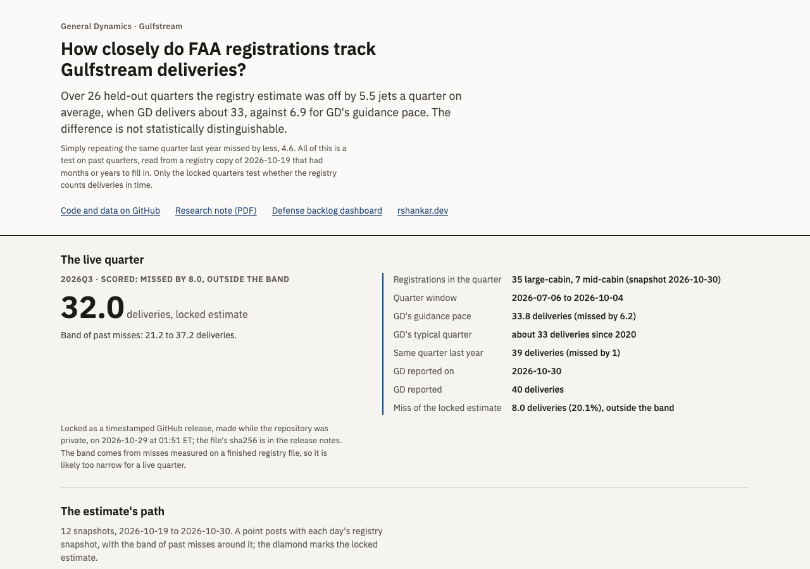

# Gulfstream delivery tracker

I estimate how many Gulfstream jets General Dynamics (GD) will report delivering each quarter from FAA aircraft registrations, test the method on 26 past quarters against GD's own guidance, and lock each live estimate on GitHub the day before GD reports.

[](https://rishabbshankar226.github.io/gulfstream-delivery-nowcast/)

The dashboard lives at https://rishabbshankar226.github.io/gulfstream-delivery-nowcast/ once the repository is public. The research note is [output/GD_research_note.pdf](output/GD_research_note.pdf), and the Excel model is [output/gd_gulfstream_model.xlsx](output/gd_gulfstream_model.xlsx).

## Results

The backtest reads a registry copy from 2026-10-19, which had months or years to fill in. It shows how well the registry tracks Gulfstream deliveries after the fact. Only the locked quarters test whether it counts them in time.

**Over 26 held-out quarters the registry count was off by 5.5 jets a quarter on average, against 6.9 for GD's guidance pace. The difference is not statistically distinguishable.**

Average miss in aircraft over the 26 held-out quarters, 2020Q1 to 2026Q2:

| Model | Average miss | Average % miss | Bias | Large cabin | Mid cabin | Without 2020 |
|---|---|---|---|---|---|---|
| Registry estimate (ratio) | 5.5 | 17.9% | 2.2 | 5.0 | 2.2 | 5.4 |
| Raw registry count | 6.2 | 18.5% | 2.4 | 5.8 | 1.8 | 5.8 |
| GD guidance pace | 6.9 | 23.2% | 3.4 | 5.5 | 2.0 | 7.4 |
| Same quarter last year | 4.6 | 15.2% | -0.6 | 4.2 | 1.5 | 4.5 |
| Last quarter | 8.8 | 29.5% | 0.1 | 7.9 | 1.9 | 8.7 |

Bias is the average of the estimate minus GD's count.

One-sided exact sign tests that the registry estimate's miss is smaller than each baseline's, with Holm's correction across the three:

| Baseline | Registry closer | Registry further | Ties | p | Holm | Relative miss | Lag-1 autocorrelation |
|---|---|---|---|---|---|---|---|
| GD's guidance pace | 14 | 12 | 0 | 0.423 | does not reject | 0.80 | 0.35 |
| The same quarter last year | 11 | 15 | 0 | 0.837 | does not reject | 1.20 | -0.19 |
| Last quarter | 16 | 10 | 0 | 0.163 | does not reject | 0.63 | 0.10 |

Relative miss is the registry estimate's average miss divided by the baseline's.

The quarter-to-quarter differences against GD's guidance pace and last quarter are positively autocorrelated, so the sign test, which treats quarters as independent, overstates how much evidence those quarters carry.

GD stated a numeric delivery outlook covering 22 of the 26 held-out quarters, so GD's guidance pace is the baseline named first. The other 4 quarters (2021Q1, 2021Q2, 2021Q3, 2021Q4) fall back to the same quarter last year, because no 2021 call stated a full-year number. On the 22 sourced quarters the guidance pace missed by 7.4 aircraft on average.

The past-miss band, built from each quarter's earlier misses only, held GD's count in 18 of 26 held-out quarters (69.2%, against a nominal 80%; exact 95% interval 48.2% to 85.7%).

The design window, 2017Q1 to 2019Q4 (12 quarters), chose **E1**: the ratio model's average miss was 5.47 under E1 and 5.58 under E2. In that window the same quarter last year missed by 5.00 and last quarter by 3.83.

## Error analysis

Average miss by year, aircraft:

| Year | Ratio | Raw | Guidance | Same quarter last year | Last quarter |
|---|---|---|---|---|---|
| 2020 | 6.47 | 8.25 | 4.23 | 5.50 | 9.50 |
| 2021 | 7.03 | 3.25 | 4.50 | 4.50 | 9.25 |
| 2022 | 6.09 | 6.00 | 2.52 | 2.25 | 8.25 |
| 2023 | 3.93 | 2.50 | 14.06 | 3.75 | 8.75 |
| 2024 | 3.04 | 3.00 | 10.97 | 6.25 | 14.00 |
| 2025 | 6.56 | 9.00 | 6.25 | 6.50 | 5.00 |
| 2026, first half | 5.60 | 16.50 | 4.86 | 2.50 | 5.00 |

Average miss by cabin, aircraft:

| Model | Large cabin | Mid cabin |
|---|---|---|
| Registry estimate (ratio) | 5.0 | 2.2 |
| Raw registry count | 5.8 | 1.8 |
| GD guidance pace | 5.5 | 2.0 |
| Same quarter last year | 4.2 | 1.5 |
| Last quarter | 7.9 | 1.9 |

GD deliveries per registry event averaged 1.18 from 2017Q1 to 2025Q2. The preregistered flag looks for quarters from 2025Q3 to 2026Q2 above the mean plus two standard deviations, where the registry would be counting fewer events per delivery than usual; none is. The drift runs the other way: the last three quarters sit at 0.69, 0.69, 0.72 against the 1.18 mean, so the registry is counting more events per delivery than usual, which the ratio's trailing scale absorbs only with a lag.

The truncation test cuts each held-out quarter's own registry events a set number of days before the quarter ends, with its four lags left whole. It stands in, crudely, for a registry that has not finished posting:

| Days cut | Average miss, aircraft |
|---|---|
| 0 | 5.5 |
| 30 | 13.5 |
| 60 | 22.9 |
| 90 | 31.7 |

Five quarters drive much of the average: 2022Q1, 2020Q2, 2025Q4, 2021Q2 and 2021Q1. No filing or call states why the registry count differed from GD's count in any of them. The full write-up is in [results/error_analysis.md](results/error_analysis.md).

| Quarter | Estimate | GD reported | Signed error | Registry large | Registry mid | GD large | GD mid |
|---|---|---|---|---|---|---|---|
| 2022Q1 | 40.7 | 25 | 15.7 | 32 | 6 | 21 | 4 |
| 2020Q2 | 18.5 | 32 | -13.5 | 13 | 2 | 26 | 6 |
| 2025Q4 | 58.4 | 45 | 13.4 | 57 | 8 | 41 | 4 |
| 2021Q2 | 31.7 | 21 | 10.7 | 24 | 1 | 18 | 3 |
| 2021Q1 | 38.1 | 28 | 10.1 | 27 | 1 | 25 | 3 |

## Live record

- **2026Q3**: locked at 32.0 (band 21.2 to 37.2) from the 2026-10-29 snapshot, as a timestamped GitHub release ([`lock-2026Q3`](https://github.com/rishabbshankar226/gulfstream-delivery-nowcast/releases/tag/lock-2026Q3)) at 01:51 ET on 2026-10-29, sha256 `3c4cdbd01b8a5c6928b83b4d8cbcf32964c680a46af1a4bd8b5207296b406f23`; GD's guidance pace for the quarter was 33.8. GD reported 40: the lock missed by 8.0, outside the band.
- **2026Q4**: not locked yet. Its window runs to 2026-12-31, so the 2026-11-01 snapshot counts only part of it and no estimate is shown yet.

## Method

**The count.** I read the FAA's `ReleasableAircraft.zip` and keep every aircraft type whose maker or model name contains GULFSTREAM and whose engines are turbojet or turbofan. That keeps the G280, which the registry files under the maker `IAI LTD`, and drops Gulfstream's old turboprops. An airframe is the first three characters of its maker-model code plus its serial number, gathered across the current registrations (MASTER) and the cancelled ones (DEREG). For each airframe I take:
- **E1**: the earlier of the first customer's registration certificate and the cancellation of Gulfstream's own registration for export;
- **E2**: the earlier of the first customer's certificate and any cancellation of Gulfstream's own registration.

Either date must fall within a year of the airframe's first airworthiness date (or by the end of the year after its year of manufacture), which keeps out renewed certificates and most used jets. I count the dates in each of GD's fiscal quarters, by cabin size.

**The models.** For each quarter and cabin, the ratio model scales the registry count by how many deliveries GD reported per registry event over the four quarters before. The baselines are the same quarter last year, the last quarter, and GD's guidance pace: the full-year outlook from GD's latest call, less the deliveries already reported that year, spread over the remaining quarters by their usual share of the year. I also report the raw registry count.

**The test.** The design window, 2017Q1 to 2019Q4, chose between E1 and E2 before I computed anything for a later quarter, and the rules were committed in [docs/PREREGISTRATION.md](docs/PREREGISTRATION.md) before the held-out quarters were scored. Over the 26 held-out quarters, 2020Q1 to 2026Q2, I run one-sided exact sign tests against each baseline with Holm's correction, report the relative miss and the autocorrelation of the differences, and build a past-miss band for each quarter from the earlier quarters' misses only. A truncation test cuts each quarter's own events 30, 60 and 90 days early, and a coverage-drift check watches the latest quarters.

**Live.** Each day my Mac downloads the registry, writes the latest estimate and its airframe table, and, on the day before GD reports, locks the estimate as a GitHub release whose notes carry the file's sha256. When GD reports, the run scores the lock against GD's count. A GitHub workflow runs the same job as a fallback.

**The dollars.** The Aerospace estimate is the delivery estimate × trailing Aerospace revenue per delivery, services included: a mechanical estimate. The defense segments use the seasonal naive with drift, my [defense backlog study](https://rishabbshankar226.github.io/Defense-Backlog-forecast/)'s best next-quarter baseline for five other primes; applying it to GD is an assumption.

### Secondary analysis: the as-of study

Preregistered as secondary. The Wayback Machine holds 75 successful captures of `ReleasableAircraft.zip`; six quarters have one taken 20 to 30 days after the fiscal end, and four of them can be scored (2016Q3 and 2016Q4 need lag quarters before the reported series). Scored as each capture would have read it, with the quarter's own events and its four lags all from that capture, as a live estimate reads them:

| Quarter | Capture | Days after end | As-of estimate | GD reported | As-of miss | Miss on the 2026-10-19 copy |
|---|---|---|---|---|---|---|
| 2017Q1 | 2017-04-27 | 25 | 33.3 | 30 | 3.3 | 5.6 |
| 2025Q3 | 2025-10-21 | 23 | 32.4 | 39 | 6.6 | 6.8 |
| 2026Q1 | 2026-05-01 | 26 | 43.3 | 38 | 5.3 | 7.4 |
| 2026Q2 | 2026-08-03 | 29 | 42.7 | 41 | 1.7 | 3.8 |

In all four the copy from a few weeks after the quarter missed by less than the finished copy, and its past-miss band held GD's count in two of the three held-out quarters. The archived copies held more events for the same lag quarters than the 2026-10-19 copy does (206 against 203 for 2026Q2, 146 against 63 for 2017Q1), so the later file has lost first-owner records since, as the Coverage limitation describes. In three of the four (2017Q1, 2026Q1 and 2026Q2) their estimates came out lower and, given the ratio's upward bias in the held-out quarters, closer. In 2025Q3 both copies missed low, and the archived copy, with two more of the quarter's own events, came out slightly higher. Four quarters prove nothing; the locked quarters remain the real test. Details: [results/exploratory/asof.md](results/exploratory/asof.md).

### Exploratory

Nothing tried after seeing the results has changed the headline. Any variant goes in `results/exploratory/`, labelled as tried after the fact.

## Data

- **FAA aircraft registry**: `ReleasableAircraft.zip` from https://registry.faa.gov/database/ReleasableAircraft.zip, the `ACFTREF`, `MASTER` and `DEREG` files. The backtest reads the snapshot downloaded on 2026-10-19; [data/snapshots/](data/snapshots/) keeps the in-scope rows of every stored snapshot with their hashes, so the raw zip stays out of git. The G280 appears under the maker `IAI LTD` with the model `GULFSTREAM G280`, so a scope rule on the maker name alone would drop every mid-cabin delivery.
- **GD's reported deliveries**: the "Gulfstream Aircraft Deliveries (units)" table of each earnings release (Exhibit 99.1 to the results 8-K), 2016Q1 to 2026Q2. GD counts on the delivered basis it adopted with ASC 606 on 2017-01-01, so 2016 comes from the restated prior-year columns of the 2017 releases. Every count carries its accession number in [data/processed/gd_deliveries.csv](data/processed/gd_deliveries.csv).
- **GD's guidance**: the full-year delivery outlook stated on each earnings call from 2020-01-29 to 2026-07-29, read from call transcripts (Motley Fool, with MarketBeat where no Fool page loaded), with the quote, speaker and link in [data/guidance.csv](data/guidance.csv).
- **Segments and backlog**: revenue and operating earnings by segment, 2024Q3 to 2026Q2, and the 2026Q2 backlog, from the same releases.
- **Claims in the note**: [report/claims.json](report/claims.json), each with a verbatim quote and the sha256 of the cached source. The cached sources stay out of git.

## Limitations

- **Export.** A jet exported to a foreign registry without a US registration leaves no US record, so the registry never sees that delivery. Since 2022 the registry's yearly mid-cabin count has stayed within a few jets of GD's, so G280 exports do not look like a large gap now.
- **Processing.** Registry processing can lag by months. The backtest reads events by their stamped date in a file that had years to fill in, while a live estimate sees only what has posted; the truncation table shows how fast the miss grows when a quarter's own events are cut early.
- **Military.** Military and special-mission airframes may never reach the civil registry, though GD may count them as deliveries.
- **Handover.** GD counts a delivery at its own handover. A registration or cancellation date only approximates that day, so an event can land in the quarter before or after.
- **Coverage.** The ratio assumes the registry's coverage of GD's count holds steady from one year to the next. It drifted: registry events per reported delivery rose from 0.52 in 2016 to 0.80 in 2019, and sat below 0.5 for mid cabin in 2016 and 2017, because the registry keeps only an airframe's current certificate and a resold or renewed jet loses its first owner's date.
- **Used jet.** A used jet with no airworthiness date or year of manufacture, or one whose maker code changed between registrations, can read as a new delivery, as can an imported used jet with a new US airworthiness date.
- **Band.** The past-miss band comes from misses measured on a finished registry file, so it is likely too narrow at a live lock, when recent registrations have not posted.
- **Audit.** I checked 30 airframes against outside sources ([docs/build/AIRFRAME_AUDIT.csv](docs/build/AIRFRAME_AUDIT.csv)). In 10 of 30 (33.3%) the source disagreed with the registry reading or could not confirm it: five were used jets (four let through by a fresh US airworthiness date, one with no airworthiness date or year at all), two had a stated delivery earlier than the registry date (a military G-V by one quarter, under E2 only, and a G650ER by two), and three could not be confirmed. All but one source was a registry mirror or aircraft-history site, because Gulfstream rarely names individual airframes, so the audit checks the reading more than it checks delivery dates. Every event the audit could date fell between 2000 and 2019, so it says little about recent quarters.

## Reproduce

```bash
make all
make test
```

`make all` rebuilds every result, the workbook, the charts, the note and the dashboard data from the tracked files, offline: it never downloads a snapshot, reads SEC, locks or scores. `make data` refetches GD's releases from SEC when the raw files are missing (set `SEC_UA` or write your name and email to `~/.sec_ua`).

The live job is `make daily`. I run it on my Mac once a day until each quarter is scored, because the FAA's site sits behind bot blocking that has refused GitHub's runners; on the Mac it downloads through curl or, failing that, through my own Chrome. The [nowcast workflow](.github/workflows/nowcast.yml) runs the same job twice a day as a fallback and can lock from either run on the release date's eve. An independent gate outside this repository rebuilds every figure from the stored registry subsets and checks it.

Rishabb Shankar, [rshankar.dev](https://rshankar.dev)
