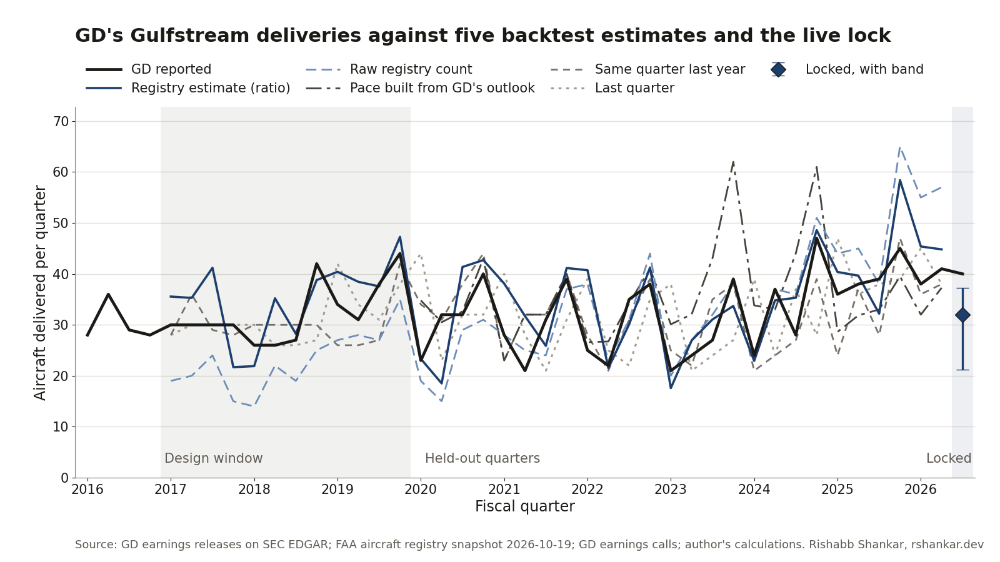

# Gulfstream delivery tracker

I test how closely FAA aircraft registrations track the Gulfstream deliveries General Dynamics (GD) reports each quarter. I scale the registry count into an estimate, check it on 26 past quarters against a pace built from GD's own guidance and two simple rules, and lock each live estimate on GitHub the day before GD reports.

<!-- live-summary:start -->
**Live record so far: one locked quarter, a miss outside its band.** For 2026Q3 I locked an estimate of 32.0 Gulfstream deliveries (band 21.2 to 37.2) the day before GD reported. GD reported 40, so the lock missed by 8.0 (20%), outside the band, whose nominal level is 80% and which held 18 of 26 held-out quarters. My pace from GD's outlook missed by 6.2 and the same quarter last year (39) by 1.

**Backtest, 26 held-out quarters:** the registry estimate missed by 5.5 jets a quarter on average, my pace from GD's outlook by 6.9 and the same quarter last year by 4.6. Simply repeating the same quarter last year missed by least. None of the three preregistered sign tests finds the registry estimate better than a baseline. The backtest reads a registry copy that had months or years to fill in.
<!-- live-summary:end -->

[](https://rishabbshankar226.github.io/gulfstream-delivery-nowcast/)

Dashboard: https://rishabbshankar226.github.io/gulfstream-delivery-nowcast/. Research note: [output/GD_research_note.pdf](output/GD_research_note.pdf). Excel model: [output/gd_gulfstream_model.xlsx](output/gd_gulfstream_model.xlsx).

Student research project. Not investment advice. I hold no position in General Dynamics as of 2026-11-12, and I am not affiliated with General Dynamics, Gulfstream or the FAA.

## Results

The backtest reads a registry copy from 2026-10-19, which had months or years to fill in. It shows how well the registry tracks Gulfstream deliveries after the fact. Only the locked quarters test whether it counts them in time.

**Over 26 held-out quarters the registry count was off by 5.5 jets a quarter on average, against 6.9 for GD's guidance pace. The difference is not statistically distinguishable. Simply repeating the same quarter last year missed by less on average, 4.6.**

In that sentence the registry count is the scaled registry estimate, the table's first row, not the raw registry count in its second. GD's guidance pace is my construction, not a figure GD publishes: GD's full-year delivery outlook, less the deliveries already reported, spread over the remaining quarters by their usual share of the year.

Average miss in aircraft over the 26 held-out quarters, 2020Q1 to 2026Q2:

| Model | Average miss | Average % miss | Bias | Large cabin | Mid cabin | Without 2020 |
|---|---|---|---|---|---|---|
| Registry estimate (ratio) | 5.5 | 17.9% | 2.2 | 5.0 | 2.2 | 5.4 |
| Raw registry count | 6.2 | 18.5% | 2.4 | 5.8 | 1.8 | 5.8 |
| GD guidance pace | 6.9 | 23.2% | 3.4 | 5.5 | 2.0 | 7.4 |
| Same quarter last year | 4.6 | 15.2% | -0.6 | 4.2 | 1.5 | 4.5 |
| Last quarter | 8.8 | 29.5% | 0.1 | 7.9 | 1.9 | 8.7 |

Bias is the average of the estimate minus GD's count. Average % miss is the mean of each quarter's miss as a share of that quarter's deliveries.

One-sided exact sign tests that the registry estimate's miss is smaller than each baseline's, with Holm's correction across the three:

| Baseline | Registry closer | Registry further | Ties | p | Holm | Relative miss | Lag-1 autocorrelation |
|---|---|---|---|---|---|---|---|
| GD's guidance pace | 14 | 12 | 0 | 0.423 | does not reject | 0.80 | 0.35 |
| The same quarter last year | 11 | 15 | 0 | 0.837 | does not reject | 1.20 | -0.19 |
| Last quarter | 16 | 10 | 0 | 0.163 | does not reject | 0.63 | 0.10 |

Relative miss is the registry estimate's average miss divided by the baseline's.

The quarter-to-quarter differences against GD's guidance pace and last quarter are positively autocorrelated, so the sign test, which treats quarters as independent, overstates how much evidence those quarters carry. With 26 quarters one standard error of an autocorrelation is about 0.20, so only the one against GD's guidance pace is more than one standard error above zero.

GD stated a numeric delivery outlook covering 22 of the 26 held-out quarters, so GD's guidance pace is the baseline named first. The other 4 quarters (2021Q1, 2021Q2, 2021Q3, 2021Q4) fall back to the same quarter last year, because no 2021 call gave a full-year figure that the preregistered rule reads. On the 22 sourced quarters the guidance pace missed by 7.4 aircraft on average. One reading matters here. On its 2021-01-27 call GD gave the year only as a change from 2020, "10 fewer aircraft", and the preregistered rule reads a change only when its base figure is in the same sentence, so it reads no number. Read as 117, the guidance pace misses by 6.7 on average, not 6.9, and the registry estimate is closer in 13 of 26 quarters. A second one: my pace reads only GD's full-year outlook, and on six calls held inside a held-out quarter GD also gave a number for that quarter's deliveries. On 2023-07-26 it said "We now expect to deliver 27 aircraft in the third quarter, with a rapid increase in the fourth quarter deliveries", when my pace for 2023Q3 says 43.1. With GD's stated plans in place of my pace in those quarters, the baseline misses by 6.0 on average, not 6.9, and the registry estimate is closer in 12 of 26 quarters. With both readings together the baseline misses by 5.7, against 5.5 for the registry estimate, which is then closer in 11 of 26 quarters. These and the other variants I tried afterwards are in [results/exploratory/sensitivity.md](results/exploratory/sensitivity.md).

The past-miss band, built from each quarter's earlier misses only, held GD's count in 18 of 26 held-out quarters (69.2%, against a nominal 80%; exact 95% interval 48.2% to 85.7%).

The design window, 2017Q1 to 2019Q4 (12 quarters), chose **E1**: the ratio model's average miss was 5.47 under E1 and 5.58 under E2. In that window the same quarter last year missed by 5.00 and last quarter by 3.83, so both simple rules were closer there too. The two definitions count the same in 11 of the 12 design quarters and differ by one airframe in 2019Q4, so the choice decided little: under E2 the held-out miss is 5.47, against 5.52 under E1.

## Error analysis

Average miss by year, aircraft:

| Year | Ratio | Raw | Guidance | Same quarter last year | Last quarter |
|---|---|---|---|---|---|
| 2020 | 6.47 | 8.25 | 4.23 | 5.50 | 9.50 |
| 2021 | 7.03 | 3.25 | 4.50 | 4.50 | 9.25 |
| 2022 | 6.09 | 6.00 | 2.52 | 2.25 | 8.25 |
| 2023 | 3.93 | 2.50 | 14.06 | 3.75 | 8.75 |
| 2024 | 3.04 | 3.00 | 10.97 | 6.25 | 14.00 |
| 2025 | 6.56 | 9.00 | 6.25 | 6.50 | 5.00 |
| 2026, first half | 5.60 | 16.50 | 4.86 | 2.50 | 5.00 |

The registry estimate's lower average miss than the guidance pace comes from 2023 and 2024, when the guidance pace missed by 12.5 on average and the registry estimate by 3.5. In the other 18 held-out quarters the guidance pace missed by 4.4, the same quarter last year by 4.4 and the registry estimate by 6.4. The guidance pace has been closer in each of the last five quarters, the locked one included.

Average miss by cabin, aircraft:

| Model | Large cabin | Mid cabin |
|---|---|---|
| Registry estimate (ratio) | 5.0 | 2.2 |
| Raw registry count | 5.8 | 1.8 |
| GD guidance pace | 5.5 | 2.0 |
| Same quarter last year | 4.2 | 1.5 |
| Last quarter | 7.9 | 1.9 |

GD deliveries per registry event averaged 1.18 from 2017Q1 to 2025Q2. The preregistered flag looks for quarters from 2025Q3 to 2026Q2 above the mean plus two standard deviations, where the registry would be counting fewer events per delivery than usual; none is. The flag is one-sided: it cannot fire on a fall. The drift runs the other way: the last three held-out quarters sit at 0.69, 0.69, 0.72 against the 1.18 mean, so the registry is counting more events per delivery than usual, which the ratio's trailing scale absorbs only with a lag.

The truncation test cuts each held-out quarter's own registry events a set number of days before the quarter ends, with its four lags left whole. It stands in, crudely, for a registry that has not finished posting, and shows how fast the miss grows when a quarter's registrations post late:

| Days cut | Average miss, aircraft |
|---|---|
| 0 | 5.5 |
| 30 | 13.5 |
| 60 | 22.9 |
| 90 | 31.7 |

That table is not a model of a live lock. The 2026Q3 lock read a snapshot taken 25 days after the quarter ended, when the quarter's count stood at 42, and it stands at 44 in the 2026-11-24 snapshot. The four quarters before gave 0.76 deliveries per registry event, and the quarter itself came in at 0.95.

Five quarters drive much of the average: 2022Q1, 2020Q2, 2025Q4, 2021Q2 and 2021Q1. No filing or call states why the registry count differed from GD's count in any of them. The full write-up is in [results/error_analysis.md](results/error_analysis.md).

| Quarter | Estimate | GD reported | Signed error | Registry large | Registry mid | GD large | GD mid |
|---|---|---|---|---|---|---|---|
| 2022Q1 | 40.7 | 25 | 15.7 | 32 | 6 | 21 | 4 |
| 2020Q2 | 18.5 | 32 | -13.5 | 13 | 2 | 26 | 6 |
| 2025Q4 | 58.4 | 45 | 13.4 | 57 | 8 | 41 | 4 |
| 2021Q2 | 31.7 | 21 | 10.7 | 24 | 1 | 18 | 3 |
| 2021Q1 | 38.1 | 28 | 10.1 | 27 | 1 | 25 | 3 |

## Live record

- **2026Q3**: locked at 32.0 (band 21.2 to 37.2) from the 2026-10-29 snapshot, as a timestamped GitHub release, made while the repository was private ([`lock-2026Q3`](https://github.com/rishabbshankar226/gulfstream-delivery-nowcast/releases/tag/lock-2026Q3)) at 01:51 ET on 2026-10-29, sha256 `3c4cdbd01b8a5c6928b83b4d8cbcf32964c680a46af1a4bd8b5207296b406f23`. GD reported 40 on 2026-10-30: the lock missed by 8.0 (20%), outside the band. Other misses for the quarter: GD's guidance pace (33.8) by 6.2, the raw registry count (42) by 2, the same quarter last year (39) by 1, last quarter (41) by 1. Of the 42 events in the raw count, 5 were airframes at least three years old by the registry's year of manufacture, so the raw count is not a count of new jets. My pace split the 81 jets GD's outlook left for the rest of the year by the last three years' pattern and said 33.8; an even split would have said 40.5.
- **2026Q4**: not locked yet. Its window runs to 2026-12-31, so the 2026-11-24 snapshot counts only part of it and no estimate is shown yet. The working file `results/live/2026Q4_latest.json` holds that part count and is not an estimate of the quarter. No release date is set in `config/calendar.json` yet, so no lock is scheduled.

## Method

**The count.** I read the FAA's `ReleasableAircraft.zip` and keep every aircraft type whose maker or model name contains GULFSTREAM and whose engines are turbojet or turbofan. That keeps the G280, which the registry files under the maker `IAI LTD`, and drops Gulfstream's old turboprops. An airframe is the first three characters of its maker-model code plus its serial number, gathered across the current registrations (MASTER) and the cancelled ones (DEREG). For each airframe I take:
- **E1**: the earlier of the earliest customer registration certificate the registry still shows and the cancellation of Gulfstream's own registration for export;
- **E2**: the earlier of that customer certificate and any cancellation of Gulfstream's own registration.

Either date must fall no later than 365 days after the airframe's first airworthiness date (or by the end of the year after its year of manufacture). The bound is one-sided: a date before the airworthiness date passes. It keeps out renewed certificates and most used jets, though not all of them, as the Used jet limitation shows. I count the dates in each of GD's fiscal quarters, by cabin size.

**The models.** For each quarter and cabin, the ratio model scales the registry count by how many deliveries GD reported per registry event over the four quarters before. The baselines are the same quarter last year, the last quarter, and GD's guidance pace: the full-year outlook from the latest GD call that stated a number, less the deliveries already reported that year, spread over the remaining quarters by their usual share of the year. The pace is my construction; GD publishes no quarterly figure. I also report the raw registry count.

**The test.** The design window, 2017Q1 to 2019Q4, chose between E1 and E2 before I scored any later quarter, and the rules were committed in [docs/PREREGISTRATION.md](docs/PREREGISTRATION.md) before the held-out quarters were scored. The commit order is all that backs the words "held out" and "preregistered" here: the registry counts and GD's counts for every quarter were already in the repository when the definition was chosen, and the rules were committed two minutes before the held-out scores, in the same build session. Only the locked quarters are out of sample in the strict sense. Over the 26 held-out quarters, 2020Q1 to 2026Q2, I run one-sided exact sign tests against each baseline with Holm's correction, report the relative miss and the autocorrelation of the differences, and build a past-miss band for each quarter from the earlier quarters' misses only. A truncation test cuts each quarter's own events 30, 60 and 90 days early, and a coverage-drift check watches the latest quarters. The rules for reading GD's calls quote two of the transcripts, so they were written with those calls in hand, and exactly 22 quarters meet the threshold of 22 for naming the guidance pace first.

**Live.** A GitHub workflow runs the daily job twice a day: it downloads the registry, writes the latest estimate and its airframe table, and, on the day before GD reports, locks the estimate as a GitHub release whose notes carry the file's sha256. When GD reports, the run scores the lock against GD's count. The same job runs on my Mac with `make daily`. A lock needs GD's release date, which I add to `config/calendar.json` by hand once GD announces it; a quarter with no date there gets no lock. The 2026Q3 lock was made by the workflow while this repository was private, so nobody outside could see it before GD reported: the release time is GitHub's, and the release notes and tag can be checked against the file, but not the absence of later edits. The job now refuses four things the preregistered text does not mention: a lock from a registry subset dated on or before the quarter's end, a score for a lock published at or after the time the SEC accepted GD's filing, a score for a lock when the SEC gives no acceptance time to check it against, and a lock record whose file differs from the release tag. [docs/prepub/ERRATA.md](docs/prepub/ERRATA.md) dates them (E9).

**The dollars.** The Aerospace estimate is the delivery estimate × trailing Aerospace revenue per delivery, services included: a mechanical estimate. GD's 10-Q reports aircraft manufacturing revenue and aircraft services revenue separately, and the estimate does not use that split: it scales services revenue with the delivery count along with everything else. The defense segments use the seasonal naive with drift, my [defense backlog study](https://rishabbshankar226.github.io/Defense-Backlog-forecast/)'s best next-quarter baseline for five other primes; applying it to GD is an assumption.

### Secondary analysis: the as-of study

Preregistered as secondary. The Wayback Machine holds 75 successful captures of `ReleasableAircraft.zip`; six quarters have one taken 20 to 30 days after the fiscal end, and four of them can be scored (2016Q3 and 2016Q4 need lag quarters before the reported series). Scored as each capture would have read it, with the quarter's own events and its four lags all from that capture, as a live estimate reads them:

| Quarter | Capture | Days after end | As-of estimate | GD reported | As-of miss | Miss on the 2026-10-19 copy |
|---|---|---|---|---|---|---|
| 2017Q1 | 2017-04-27 | 25 | 33.3 | 30 | 3.3 | 5.6 |
| 2025Q3 | 2025-10-21 | 23 | 32.4 | 39 | 6.6 | 6.8 |
| 2026Q1 | 2026-05-01 | 26 | 43.3 | 38 | 5.3 | 7.4 |
| 2026Q2 | 2026-08-03 | 29 | 42.7 | 41 | 1.7 | 3.8 |

In all four the copy from a few weeks after the quarter missed by less than the finished copy, and its past-miss band held GD's count in two of the three held-out quarters. The archived copies held more events for the same lag quarters than the 2026-10-19 copy does (206 against 203 for 2026Q2, 146 against 63 for 2017Q1), so the later file has lost certificate records since, as the Coverage limitation describes. In three of the four (2017Q1, 2026Q1 and 2026Q2) their estimates came out lower and, given the ratio's upward bias in the held-out quarters, closer. In 2025Q3 both copies missed low, and the archived copy, with two more of the quarter's own events, came out slightly higher. Four quarters prove nothing; the locked quarters remain the real test. Details: [results/exploratory/asof.md](results/exploratory/asof.md).

### Exploratory

The headline is the preregistered figure, whatever I tried afterwards. Two readings of GD's calls that I tried afterwards would each lower the guidance pace's miss, and Results says by how much. Any variant goes in `results/exploratory/`, labelled as tried after the fact. [results/exploratory/sensitivity.md](results/exploratory/sensitivity.md) holds the variants a reader is most likely to ask for: GD's January 2021 statement read as a number, GD's stated plans for single quarters, the comparison without 2020, without 2023 and 2024, and under the other event definition.

## Data

- **FAA aircraft registry**: `ReleasableAircraft.zip` from https://registry.faa.gov/database/ReleasableAircraft.zip, the `ACFTREF`, `MASTER` and `DEREG` files. The backtest reads the snapshot downloaded on 2026-10-19; [data/snapshots/](data/snapshots/) keeps the in-scope rows of every stored snapshot with their hashes, so the raw zip stays out of git. Those rows are the FAA's public file as released, so they carry the registrant names and addresses the FAA publishes. The G280 appears under the maker `IAI LTD` with the model `GULFSTREAM G280`, so a scope rule on the maker name alone would drop nearly every mid-cabin delivery.
- **GD's reported deliveries**: the "Gulfstream Aircraft Deliveries (units)" table of each earnings release (Exhibit 99.1 to the results 8-K), 2016Q1 to 2026Q2 for the backtest, then each scored live quarter from its own release. GD restated its 2016 delivery counts when it adopted ASC 606 on 2017-01-01 (the 2016 releases had printed green and outfitted counts), so 2016 comes from the restated prior-year columns of the 2017 releases. From 2017Q1 on, every count is the one GD first reported; no later release has changed one. Every count carries its accession number in [data/processed/gd_deliveries.csv](data/processed/gd_deliveries.csv), where `filed` is the filing date of the release the count was read from. Each restated 2016 count was first printed in the release for the same quarter of 2017 (the `filed` column of [data/processed/gd_deliveries.csv](data/processed/gd_deliveries.csv)), so the design window's 2017 estimates rest on 2016 counts that were not public in that form when those quarters ended. No held-out quarter uses a 2016 count. GD's 2025 annual report records a new aircraft's revenue "generally upon delivery and acceptance by the customer of the fully outfitted aircraft" (accession 0000040533-26-000006). The count can include test aircraft and demonstrators GD sells: on its 2022-01-26 call GD said 2021's deliveries included "a number of test aircraft" and "a few demonstrators all up about 11 aircraft".
- **GD's guidance**: the full-year delivery outlook stated on each earnings call from 2020-01-29 to 2026-10-30, read from call transcripts (Motley Fool, with MarketBeat where no Fool page loaded), with the quote, speaker and link in [data/guidance.csv](data/guidance.csv). The plans GD stated for single quarters, which my pace does not use, are in [data/quarter_plans.csv](data/quarter_plans.csv).
- **Segments and backlog**: revenue and operating earnings by segment, 2024Q3 to 2026Q2, and the 2026Q2 backlog, from the same releases. What GD reported by segment for a scored live quarter is in [data/processed/segments_reported.csv](data/processed/segments_reported.csv).
- **Claims in the note**: [report/claims.json](report/claims.json), each with a verbatim quote and the sha256 of the cached source. The hash is of the bytes as I fetched them, so a later download of the same page may not match it. The cached sources stay out of git.

## Limitations

- **Export.** A jet exported to a foreign registry without a US registration leaves no US record, so the registry never sees that delivery. Since 2022 the registry's yearly mid-cabin count has stayed within a few jets of GD's, so G280 exports do not look like a large gap now, though some of those mid-cabin events are used jets (see Used jet), so the match is looser than it looks.
- **Processing.** Registry processing can lag by months. The backtest reads events by their stamped date in a file that had months or years to fill in, while a live estimate sees only what has posted; the truncation table shows how fast the miss grows when a quarter's own events are cut early. The finished file is not simply the more complete one, though: it has also lost first-owner records as jets changed hands, as the as-of study above shows.
- **Military.** Military and special-mission airframes may never reach the civil registry, though GD may count them as deliveries.
- **Handover.** GD counts a delivery at its own handover. A registration or cancellation date only approximates that day, so an event can land in the quarter before or after.
- **Coverage.** The ratio assumes the registry's coverage of GD's count holds steady from one year to the next. It drifted: GD deliveries per registry event fell from 1.92 in 2016 to 1.26 in 2019, and sat above 2 for mid cabin in 2016 and 2017, because the registry keeps only an airframe's current certificate and a resold or renewed jet loses its first owner's date. A check I had set for the build, registry coverage of at least half of GD's count for each cabin and year, failed for mid cabin in 2016 and 2017. I stopped, found this cause, and kept the definitions as preregistered ([docs/build/DECISIONS.md](docs/build/DECISIONS.md), Phase 2). That check is in the build notes, not in the preregistration. In the last three held-out quarters GD delivered 0.69 to 0.72 jets per registry event, as the Error analysis shows.
- **Used jet.** A used jet with no airworthiness date or year of manufacture, or one whose maker code changed between registrations, can read as a new delivery, as can an imported used jet with a new US airworthiness date. This is not rare. By the registry's own year of manufacture, 246 of the 1,251 events counted from 2016Q1 to 2026Q2 (19.7%) are airframes at least three years old, and 76 more carry no year. In the 2026Q3 lock, 5 of the 42 events were airframes at least three years old by that field. Two airframes are also counted twice, under two maker-code prefixes: a G150 in 2016Q2 and again in 2018Q2, and a G280 first registered to a customer in 2012 that counts again in 2026Q2. The FAA added a third G280 type code in October 2026, so this can recur. The cabin rule files 11 airframes of older mid-cabin types as large cabin because their model names lack the patterns it looks for; none of them has an event in the tested quarters. And 386 of the 4,053 airframes have no airworthiness date and no year, so no bound applies to them: they supply 75 of the 1,251 counted events.
- **Mid-cabin gap.** The mid-cabin count rests on the G280 alone. On its 2026-07-29 call GD said the final G280 "ought to deliver in the second quarter of next year", meaning 2027, with the G300 to follow around late 2027 or early 2028 and "a planned production break" between them. No held-out quarter had fewer than 3 mid-cabin deliveries, so the method is untested through that break.
- **Holder and scope.** The holder rule matches registrant names that start `GULFSTREAM AEROSPACE`. It misses `GULFSTREAM LEASING LLC`, whose four registrations in 2020Q4 and 2025Q4 count as deliveries. The scope rule keeps engine-type codes 4 and 5. The FAA files one G700 type code (`3980222`) under engine-type code 2, so the 17 G700s registered to Gulfstream under it on 2026-10-30 are outside the count and outside the dashboard's chart of jets on Gulfstream's own registration. None of them had a delivery event by then, so no past count is short, but their deliveries will not be counted unless I amend the rule. Both rules are preregistered and stand as written; [docs/prepub/ERRATA.md](docs/prepub/ERRATA.md) records the gap and the amendment to decide before the next lock.
- **Band.** The past-miss band comes from misses measured on one finished registry file, so it may not fit a live lock. It held GD's count in 18 of the 26 held-out quarters against a nominal 80%, and the first lock fell outside it.
- **Audit.** I checked 30 airframes against outside sources ([docs/build/AIRFRAME_AUDIT.csv](docs/build/AIRFRAME_AUDIT.csv)). In 10 of 30 (33.3%) the source disagreed with the registry reading or could not confirm it: five were used jets (four let through by a fresh US airworthiness date, one with no airworthiness date or year at all), two had a stated delivery earlier than the registry date (a military G-V by one quarter, under E2 only, and a G650ER by two), and three could not be confirmed. All but one source was a registry mirror or aircraft-history site, because Gulfstream rarely names individual airframes, so the audit checks the reading more than it checks delivery dates. Every event the audit could date fell between 2000 and 2019, so it says little about recent quarters.

## Reproduce

```bash
python3.11 -m venv .venv
.venv/bin/python -m pip install -r requirements.lock
make all
make test
```

The pinned requirements need Python 3.11 or later; an older `python3` fails at the install step.

`make all` rebuilds every result, the workbook, the charts, the note and the dashboard data from the tracked files, offline: it never downloads a snapshot, reads SEC, locks or scores. `make data` refetches GD's releases from SEC when the raw files are missing (set `SEC_UA` or write your name and email to `~/.sec_ua`).

The live job is `make daily`. The [nowcast workflow](.github/workflows/nowcast.yml) runs it twice a day and can lock from either run on the release date's eve; every daily commit since 2026-10-31 has come from the workflow. The FAA's download refuses some automated clients, so the job sends ordinary browser headers, and a download can still fail. When it does, the run says so and carries on with the newest stored snapshot, and a quarter with no fresh snapshot after its fiscal end goes without a lock. On my Mac the job falls back to my own Chrome. The workflow cannot print the note's PDF, so after a lock or a score I rebuild it on the Mac with `make pdf`.

## License and data

The code is under the [MIT license](LICENSE). The FAA registry data is a U.S. government work. GD's filings and the short call quotes belong to their owners and are quoted for reference.

Student research project. Not investment advice. Rishabb Shankar, [rshankar.dev](https://rshankar.dev)
